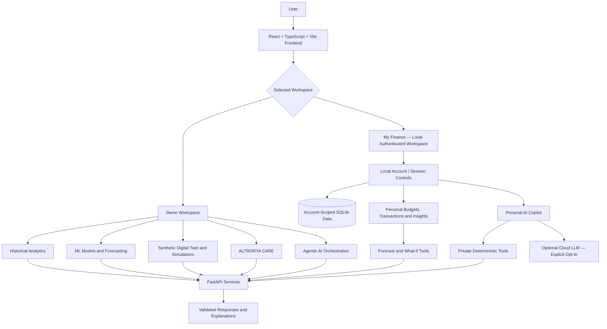

# ALTRORYA
Demo website : https://altrorya-web-production.up.railway.app/

Source Code : https://drive.google.com/drive/folders/1DJ_RvQ0rp3WuMnXXCRMPBk_9ETEGsGqs

### AI-Powered Personal Financial Intelligence, Forecasting and Decision Support

**ALTRORYA** is a modular financial intelligence platform built to help people understand their money, anticipate financial pressure, explore possible outcomes, and make more informed everyday decisions. It brings together personal finance management, machine learning, financial simulations, explainable risk signals, an agentic AI workspace, and financial resilience tools in a unified interface.

The project was developed independently for **FinTechathon 2026** as a research and demonstration prototype. It is designed around a simple question:

> What if a financial application could go beyond showing where money went, and help people understand what might happen next?

ALTRORYA explores that question through two deliberately separate environments:

- **Demo Workspace** — showcases AI/ML capabilities with historical and synthetic financial datasets.
- **My Finance** — an authenticated, local-only personal finance workspace that uses data entered or imported by its signed-in user.

**Project status:** Functional local prototype and competition demonstration. It is **not** a production banking service, certified financial adviser, or live bank-connected application.

---

## Table of Contents

1. [Vision and Problem Statement](#vision-and-problem-statement)
2. [Core Capabilities](#core-capabilities)
3. [Two-Workspace Design](#two-workspace-design)
4. [System Architecture](#system-architecture)
5. [AI and Machine Learning](#ai-and-machine-learning)
6. [ALTRORYA CARE](#altrorya-care)
7. [My Finance: Personal Financial Workspace](#my-finance-personal-financial-workspace)
8. [Agentic AI and LLM Integration](#agentic-ai-and-llm-integration)
9. [Multilingual Interface and Themes](#multilingual-interface-and-themes)
10. [Technology Stack](#technology-stack)
11. [Datasets and Data Boundaries](#datasets-and-data-boundaries)
12. [Project Structure](#project-structure)
13. [Installation and Local Setup](#installation-and-local-setup)
14. [Run the Backend and Frontend](#run-the-backend-and-frontend)
15. [Selected API Endpoints](#selected-api-endpoints)
16. [Testing and Verification](#testing-and-verification)
17. [Privacy and Security](#privacy-and-security)
18. [Limitations and Responsible Use](#limitations-and-responsible-use)
19. [Future Development](#future-development)
20. [Project Resources](#project-resources)
21. [Project Background and License](#project-background-and-license)

---

## Vision and Problem Statement

Many people can view their transactions but still struggle to answer practical financial questions:

- Can I afford a purchase without putting essential expenses at risk?
- What happens if my monthly income drops or my expenses increase?
- Is a recurring payment genuinely useful or simply being overlooked?
- Am I likely to face a cash-flow shortfall?
- How can I prioritize savings, debt obligations, and goals?
- Where can I explore income opportunities or assistance during hardship?

ALTRORYA combines descriptive analytics, predictive research, explicit what-if modeling, and natural-language explanations to make those decisions easier to examine.

The long-term mission is **accessible, proactive, and inclusive financial resilience**. The current implementation demonstrates the necessary components; it does not claim to have solved the validation, regulatory, security, or banking-integration challenges required for widespread deployment.

## Core Capabilities

| Capability | What it does | Scope |
| --- | --- | --- |
| Financial Dashboard | Income, spending, categories, transaction patterns, financial overview | Historical demo |
| Smart Expense Categorization | Helps interpret and categorize transactions | Demo tooling |
| Subscription Intelligence | Detects potentially recurring merchant payments | ML research and demo |
| Predictive Financial Forecasting | Estimates next-month financial indicators with trained models | Historical banking research |
| Financial Digital Twin | Creates interpretable financial snapshots and simulated trajectories | Synthetic demo profiles |
| Goal-Based Optimization | Explores goal allocation subject to financial constraints | Demo optimization |
| Financial Decision Simulator | Compares purchase and cash-flow scenarios | Hypothetical demo |
| AI Cash-Flow Calendar | Visualizes money movement and upcoming obligations | Demo visualization |
| Financial Health and Risk | Computes explainable financial-health and stress indicators | Demo and personal, separately |
| Agentic AI Workspace | Orchestrates authorized analytical tools and presents results | Demo assistant |
| ALTRORYA CARE | Crisis signals, survival planning, income matching, jobs, assistance | Demo / curated / provider-dependent |
| My Finance | Account-scoped profiles, records, budgets, goals, bills, and insights | Local personal workspace |
| Personal AI Copilot | Natural-language personal finance explanations and approved read-only tool calls | Local private mode; optional cloud mode |
| Multilingual Interface | Language preferences and translated UI catalogs | Frontend, partial coverage |
| Premium Themes | Light, dark, and Obsidian Gold visual experiences | Frontend |

## Two-Workspace Design

### 1. Demo Workspace

Demo Workspace is an environment for showcasing research models and financial intelligence workflows. Its features rely on **independent historical and synthetic datasets**. These profiles do not represent an authenticated My Finance account.

It includes a historical household dashboard, subscription detection, forecasting models, synthetic financial twins, goal optimization, decision simulation, agentic analysis, expense intelligence, cash-flow tools, and ALTRORYA CARE.

### 2. My Finance

My Finance is a separate **local-only**, session-authenticated workspace for an individual's manually supplied or imported records. It includes personal financial onboarding, transactions, planning, recurring bills, financial health, a cash-flow calendar, smart personal tools, personal projections, scenarios, and a Copilot.

**Boundary rule:** Do not silently merge demonstration data with an individual's financial history, copy modeled demo balances into a personal account, or treat hypothetical outputs as verified bank balances.

## System Architecture



The FastAPI backend contains independently addressable modules, routers, and services. The React application exposes these capabilities through a common user interface. Data processing, model inference, simulations, and authentication checks run on the backend; the frontend manages navigation, forms, state, charts, localization, and presentation.

### Architectural principles

1. **Separation of concerns:** Financial analytics, subscriptions, forecasting, simulations, planning, and agent tooling are modular.
2. **Explicit data provenance:** Historical, synthetic, user-entered, and external-source information are labeled according to their origin.
3. **Account isolation:** Personal queries are constrained by authenticated user and relevant currency.
4. **Explainability:** Model outputs and simulations should be accompanied by meaningful limitations and interpretable indicators.
5. **Permissioned AI:** Personal cloud analysis and external job discovery use explicit opt-in where implemented; personal LLM tools are read-only.
6. **Prototype honesty:** Estimates and simulations are not presented as guaranteed outcomes or live banking facts.

## AI and Machine Learning

### Financial Dashboard and Analytics

The dashboard explores transaction records, calculates financial aggregates, and visualizes financial patterns:

- Total income and outflow summaries.
- Regular spending and spending-by-category views.
- Transaction history and filtering.
- Monthly financial trends.
- Payment methods and recurring-payment candidates.
- Cash-flow and financial-health visualizations.

The main household-analytics demonstration uses the `Daily Household Transactions(2).csv` dataset. It is a historical household example, **not** a live user account.

### Smart Expense Categorization

This component is designed to interpret transaction descriptions and organize spending into categories. Project research used the **US Bank Transaction Categories V2** dataset, including descriptions, transaction categories, and debit/credit information. The application also includes interactive expense categorization and transaction-assistance screens.

No benchmark score is stated here because a verified final held-out result for this component is not included in the documented project summary.

### Subscription Detection and Recurring Payments

Subscription intelligence uses transaction history and temporal patterns to classify potentially recurring payments. The training dataset was produced using the **Synthetic Banking Dataset Generator**.

**Research dataset:** 213,341 transaction records, with 7,344 positive subscription transactions, and a related set of 674 subscription definitions.

Selected engineered features include:

- Transaction amount and amount difference.
- Time since previous merchant payment.
- Number of preceding payments to the same merchant.
- Interval consistency and previous payment interval.
- Monthly, quarterly, yearly, and similar-amount indicators.

The experimentation compared Random Forest, XGBoost, LightGBM, CatBoost, and Extra Trees. LightGBM was selected after validation and threshold tuning.

**Held-out synthetic test results:**

| Metric | Result |
| --- | ---: |
| Accuracy | 99.10% |
| Precision | 92.02% |
| Recall | 89.86% |
| F1-score | 90.93% |
| Average precision | 0.9547 |
| ROC-AUC | 0.9937 |
| Selected decision threshold | 0.72 |

These metrics apply to the **held-out synthetic research data**, not to an independently validated commercial bank population. The application also includes recurring-payment review and subscription-management interfaces. Local My Finance recurring bills are maintained separately from this trained demonstration model.

### Predictive Financial Forecasting

The forecasting research uses the **Czech Banking Dataset (PKDD '99)** with account- and transaction-level data processed into monthly records. The work includes chronological splitting, feature engineering, lag features, rolling statistics, hyperparameter search, and model comparison.

Model families explored include **XGBoost** and **CatBoost**, alongside baseline approaches. Targets include next-month income, expenses, net cash flow, and balance.

**Selected held-out test evaluation:**

| Target | Mean Absolute Error (research data) | R² |
| --- | ---: | ---: |
| Next-month income | 572.34 | 0.452 |
| Next-month expenses | 658.06 | 0.603 |
| Next-month net cash flow | 627.38 | 0.275 |
| Next-month balance | 632.15 | 0.765 |

The MAE values are expressed in the **research dataset's monetary scale** and must not be interpreted as BDT, INR, USD, or an error guarantee for a new user. The trained forecasting endpoint belongs to Demo Workspace.

**Important:** My Finance's future-money view does **not** silently run this historical model on a different person's currency or transaction schema. It uses a distinctly labeled personal-data-based projection described below.

### Financial Digital Twin

The research prototype contains **500 synthetic financial profiles** representing different financial situations, including working professionals, families, early-career individuals, and higher-income profiles.

Synthetic twin snapshots model declared or generated variables such as:

- Monthly income, expenses, and cash flow.
- Available cash and emergency funds.
- Assets, debts, and estimated net worth.
- Savings, debt-to-asset, and emergency-fund ratios.
- Financial goals and time horizons.

The simulator produces alternative trajectories, for example baseline spending, greater savings, or increased spending. A prototype audit and scenario-execution verification were performed; these results concern the **synthetic simulator**, not bank-connected personal twins.

### Goal-Based Optimization

Goal-based optimization explores how available resources may be allocated across user-defined goals while respecting constraints such as cash-flow pressure and safety buffers. It includes dedicated backend endpoints and integration paths with demonstration financial-twin scenarios.

The module is meant to demonstrate constraint-aware planning. A recommendation is not an automatic transfer, payment, investment order, or guarantee of goal achievement.

### Financial Decision Simulator

The decision simulator compares hypothetical alternatives, including purchases made immediately, delayed purchases, and installment financing. It can report ending cash position, impact relative to baseline, potential shortfalls, reserve gaps, and outstanding loan amounts.

For example, one synthetic demonstration modeled a **BDT 50,000 laptop purchase** over a 12-month horizon. The reported difference between the baseline and purchase scenario was BDT 50,000 under that example's assumptions. It did not initiate a real purchase or retrieve a real bank balance.

The advanced demo Decision Lab also provides assumption-driven risk simulations. Such risk percentages depend on illustrative settings and are **not calibrated personal probabilities**.

### Financial Health, Risk Intelligence, and Cash-Flow Calendar

Additional modules include financial health indicators, expense-related risk alerts, scheduled-bill visibility, and calendar-based cash-flow planning. These tools distinguish recorded financial activity, planned amounts, and future hypothetical obligations.

## ALTRORYA CARE

**ALTRORYA CARE** focuses on financial resilience and support, especially for people under financial pressure or with irregular/limited income.

Its functional areas are:

1. **Financial crisis detection:** Analyze explainable signals such as negative cash flow, debt burden, and limited reserves.
2. **Survival recommendations:** Prioritize essential spending and suggest practical budgeting actions.
3. **Debt prevention guidance:** Surface debt-related pressure and educational repayment considerations.
4. **Income opportunity matching:** Match professions, skills, availability, and available resources to possible earning pathways.
5. **Job discovery:** Retrieve publicly sourced job opportunities and review basic relevance to the user's specified skills.
6. **Global assistance discovery:** Explore curated directories of assistance organizations and programs by country and need.

Some service modules retain the legacy `/finova-care/...` API prefix to avoid breaking existing working integrations. The public-facing application brand is **ALTRORYA**.

**External-information disclaimer:** Retrieved job postings are not independently employer-verified, and an assistance suggestion does not establish program eligibility, availability, or application approval. External providers may be unavailable or change their listings.

## My Finance: Personal Financial Workspace

My Finance is designed for **local, authenticated personal usage**. Each person's saved records are kept separate from the demonstration datasets and from other local users' accounts.

### Account and Financial Setup

- Local registration and login.
- Account preferences including selected currency.
- Personal income, expenses, debts, savings, and financial goals.
- Currency consistency checks; existing values are not automatically converted after a preference change.

### Personal Transactions

- Add, edit, delete, and review transactions.
- Money-in and money-out categories.
- Date, payment method, description, and currency support.
- CSV import with duplicate detection.
- Monthly summaries and trends.
- Controls to remove imported records separately from manual entries.

Amounts are stored using currency-aware **integer minor units** rather than unrestricted floating-point transaction storage.

### Planning and Monitoring

- Smart budget planning and progress indicators.
- Savings goals and manual goal progress.
- Recurring bills and subscription schedules.
- Financial health checks and cash-flow calendar.
- Spending risk alerts and explainable spending categorization.
- Financial SMS text analysis tools.
- Settings and account data controls.

### Personal Financial Help, Jobs, Forecast, and Scenarios

The advanced personal intelligence module reuses the logged-in user's approved local context:

- **Financial help:** Rule-based financial-pressure observations and conservative budgeting ideas.
- **Income opportunities:** Suggestions derived from declared profession, skills, available hours, and related constraints.
- **Jobs and assistance:** Separate user-requested external/curated discovery; no claim of verified eligibility.
- **Personal forecast:** An illustrative weighted average of the preceding **three completed months** (20%, 30%, 50%), requiring recorded history in each month. Insufficient history is explicitly reported instead of treating absent records as zero.
- **Personal digital twin and decision scenarios:** What-if comparisons grounded in user-entered financial setup or appropriately scoped transaction summaries.

The personal projections are **deterministic planning illustrations**, not the historical PKDD machine-learning model, a validated credit score, or a guaranteed prediction. Starting savings are user-declared, not bank-verified.

## Agentic AI and LLM Integration

ALTRORYA includes two distinct agent-related experiences.

### Demo Agentic AI Workspace

The demonstration agent coordinates financial-analysis tools, handles natural-language requests, and presents validated outputs within controlled workflows. Its development includes tool orchestration, multi-tool planning, session context, and explicit approval handling for selected sensitive demonstration actions.

Demo tools and examples are not live banking operations. Individual agent behaviors may be deterministic and should not be described as fully autonomous real-world transactions.

### Personal AI Copilot

The My Finance Copilot offers two modes:

**Private Insights (default)**

- Locally computed, rule-based answers grounded in the authenticated user's records.
- No cloud AI request is required for normal private-mode analysis.
- Explains income, expenses, categories, budgets, savings, goals, and trends without inventing missing financial data.

**Optional Cloud LLM + Financial Tools**

- Explicit, per-use opt-in for an external AI provider.
- Whitelisted **read-only** tools to retrieve authorized financial aggregates and generate illustrative explanations.
- Session-limited conversation context and server-side tool validation.
- A local fallback when the provider or tool call fails.
- No permission to create transactions, move money, purchase assets, or mutate accounts.

The OpenAI-based personal LLM integration uses a backend-controlled API key. The model receives selected aggregates and a **best-effort-redacted** form of the user's question; this is not a guarantee that every sensitive identifier will be removed. Sensitive personal information should not be placed in cloud prompts.

**Provider separation:** The optional Gemini developer script for generating UI translations is a **build-time localization utility**, not the same thing as the runtime personal Copilot.

## Multilingual Interface and Themes

ALTRORYA includes language selection for:

- English (`en`)
- Bangla / বাংলা (`bn`)
- Japanese / 日本語 (`ja`)
- Hindi / हिन्दी (`hi`)
- Simplified Chinese / 简体中文 (`zh`)

The frontend uses static translations and a localization catalog. Additional UI strings can be translated by a developer-side generation script and saved into the frontend build. **Localization coverage is still incremental**: untranslated UI text, independent module strings, and some backend responses can remain in English. Language selection does not translate user-entered transaction content.

Visual options include an existing **Light** interface, an existing **Dark** interface, and an additional **Obsidian Gold** theme with graphite surfaces, champagne-gold accents, and motion effects. Theme selection is a presentation preference; it does not alter analytics or financial calculations.

## Technology Stack

| Layer | Technologies / Techniques |
| --- | --- |
| Frontend | React, TypeScript, Vite |
| Styling and UI | CSS, Tailwind-based components, Lucide icons, premium theme styles |
| Visualization | Interactive dashboard charts, Recharts and custom SVG visualizations |
| Backend | Python, FastAPI, Uvicorn, Pydantic |
| Data analysis | pandas, NumPy |
| ML research | scikit-learn, XGBoost, LightGBM, CatBoost, Random Forest, Extra Trees |
| Model artifacts | Serialized research models (including pickle/joblib bundles) |
| Personal local persistence | SQLite |
| LLM integration | Backend-driven OpenAI API, constrained tool invocation, private fallback |
| Localization authoring | Static catalogs; optional developer-side Gemini translation generation |
| Security-related techniques | Password hashing, HttpOnly cookies, scope checks, same-origin checks, data minimization, optional cloud opt-in |
| Development environment | Python virtual environment, Node.js/npm, Windows PowerShell |

The exact installed dependencies and supported versions should be taken from the committed backend requirements file and frontend `package.json` in the current repository.

## Datasets and Data Boundaries

| Source | Used for | Important boundary |
| --- | --- | --- |
| Daily Household Transactions(2).csv | Household finance dashboard | Historical single-household example, INR-denominated |
| US Bank Transaction Categories V2 | Expense categorization research | Classification data, not an actual My Finance user's account |
| Synthetic Banking Dataset Generator | Subscription-detection ML | Synthetic merchants, customers, and payments |
| Czech Banking Dataset (PKDD '99) | Financial forecasting research | Historical research data; not calibrated to personal BDT accounts |
| Synthetic Financial Twin Profiles V2 | Digital twin, scenario simulations | Generated personas and values, not verified people |
| My Finance local account records | Personal dashboards and read-only personal tools | Logged-in user's manually entered/imported records only |
| External job feed / curated directories | Job and assistance discovery | Availability and eligibility are not independently guaranteed |

**Currencies are not interchangeable:** Demo modules may use INR, historical-model monetary units, or synthetic BDT profiles. They remain independent unless a specific, documented conversion and identity linkage is actually implemented. Personal account calculations should remain in the account's active recorded currency; visual approximate currency displays are not substitutes for authoritative exchange-rate conversion.

**Data availability:** Some research datasets and trained model artifacts are large or restricted. Their existence in the development environment does **not** imply that all original data files or model bundles are included in a public GitHub repository. Verify the files and data licenses before redistribution.

## Project Structure

A representative layout of the working application:

```text
ALTRORYA/
├── backend/
│   ├── app/
│   │   ├── main.py
│   │   ├── dashboard.py
│   │   ├── forecasting.py
│   │   ├── subscriptions.py
│   │   ├── decision_routes.py
│   │   ├── personal_accounts.py
│   │   ├── personal_finance.py
│   │   ├── personal_transactions.py
│   │   ├── personal_copilot.py
│   │   ├── personal_llm.py
│   │   ├── personal_planner.py
│   │   ├── personal_recurring.py
│   │   ├── personal_settings.py
│   │   ├── personal_smart_tools.py
│   │   ├── personal_health_calendar.py
│   │   ├── personal_advanced_intelligence.py
│   │   ├── financial_twin/
│   │   ├── financial_health/
│   │   ├── cashflow_calendar/
│   │   ├── copilot/
│   │   ├── auth/
│   │   ├── routers/
│   │   ├── services/
│   │   └── security/
│   ├── models/                     # Model artifacts, if present locally
│   ├── data/personal/              # LOCAL-ONLY private SQLite database
│   ├── .venv/                      # Local Python virtual environment
│   └── requirements.txt            # If maintained in this checkout
├── frontend/
│   ├── src/
│   │   ├── App.tsx
│   │   ├── main.tsx
│   │   ├── components/
│   │   ├── pages/
│   │   ├── services/
│   │   ├── altrorya_i18n.ts
│   │   ├── altrorya_global_i18n.ts # Full-overlay version, if installed
│   │   ├── altrorya_ui_translations.ts
│   │   └── premium.css
│   ├── tools/                       # Optional localization generator
│   ├── package.json
│   └── vite.config.ts
└── README.md
```

This tree is illustrative rather than an assertion that every optional file is committed. Certain internal identifiers and paths still contain `finova` for backward compatibility following the public rebrand to ALTRORYA.

## Installation and Local Setup

### Prerequisites

- Windows with **PowerShell** (commands below are Windows-oriented).
- Python 3.12 and `venv`, or a compatible Python version for the repository's dependencies.
- Node.js and npm compatible with the project's Vite version.
- The locally required datasets and model artifacts for whichever **Demo Workspace** modules you intend to run.
- Optional API credentials only if you explicitly want cloud Copilot or developer-time translation generation.

### 1. Clone the repository

```powershell
git clone <YOUR-REPOSITORY-URL>
cd <YOUR-REPOSITORY-FOLDER>
```

Replace the placeholders with your actual GitHub URL and cloned folder name. No repository URL is assumed here.

### 2. Set up the backend environment

From the project root:

```powershell
cd backend
python -m venv .venv
.\.venv\Scripts\python.exe -m pip install --upgrade pip
```

If the repository contains a maintained backend requirements file:

```powershell
.\.venv\Scripts\python.exe -m pip install -r requirements.txt
```

Some Demo Workspace modules also depend on local trained models and datasets. If those assets are not distributed with the repository, endpoints relying on them may return an unavailable/error response until the authorized assets are configured.

### 3. Set up the frontend environment

In a **separate terminal**, from the project root:

```powershell
cd frontend
npm install
```

If you already have the backend `.venv` and frontend `node_modules` correctly installed, you do not need to recreate them every time.

## Run the Backend and Frontend

### Backend: PowerShell terminal 1

Open a terminal in the `backend` folder and run the following **exact development commands**:

```powershell
$env:FINOVA_SUBSCRIPTIONS_DEMO = "1"
$env:FINOVA_CUSTOMER_ID = "C0000047"

.\.venv\Scripts\python.exe -m uvicorn app.main:app --reload --host 127.0.0.1 --port 8000
```

The `FINOVA_*` names are retained for compatibility with the existing subscription demo configuration. `C0000047` is a **demonstration customer identifier**, not a real connected bank customer. PowerShell environment variables apply to the current terminal session.

The API should be reachable at:

- Backend: `http://127.0.0.1:8000`
- Interactive API documentation: `http://127.0.0.1:8000/docs`

Leave this terminal running.

### Frontend: PowerShell terminal 2

Open another terminal in the `frontend` folder and run:

```powershell
npm run dev
```

The development website is normally available at:

`http://localhost:5173`

The actual port is shown in the Vite terminal output. Keep both backend and frontend terminals open while using the application.

### Optional: Check the frontend build

```powershell
npm run build
```

The successful completion of this command verifies frontend compilation/bundling in your current checkout; it does not independently prove that every backend route or external provider is available.

### Optional: Enable the Personal Cloud LLM

This is **not required** for local Private Insights. To use the optional external LLM, supply its API key in the **same backend terminal before starting Uvicorn**, without placing it in source code:

```powershell
$secret = Read-Host "OpenAI API key" -AsSecureString
$env:OPENAI_API_KEY = [System.Net.NetworkCredential]::new("", $secret).Password
Remove-Variable secret
$env:ALTRORYA_PERSONAL_AI_MODEL = "gpt-4.1-mini"
```

Model access and API billing depend on the provider account. The personal cloud analysis interface must still be explicitly enabled by the user. Never put a private API key in a frontend `VITE_*` variable.

### Optional: Localize additional static UI text

A developer-side translation tool may be available at `frontend/tools/translate_ui_catalog.py`. It can generate static locale strings from UI source text using an independently configured translation provider. This utility is **not required to start the application**, and any API calls may consume quota or incur costs. Existing untranslated strings may fall back to English.

## Selected API Endpoints

The following are representative endpoints/prefixes, not an exhaustive autogenerated API reference. Use `/docs` for the complete router listing of the checkout you actually run.

| Method | Endpoint or prefix | Purpose |
| --- | --- | --- |
| GET | `/dashboard/overview` | Historical dashboard overview |
| GET | `/dashboard/categories` | Historical spending categories |
| GET | `/dashboard/transactions` | Historical transaction view |
| GET | `/dashboard/recurring` | Historical recurring candidates |
| POST | `/forecast/predict` | Historical-model next-month prediction |
| GET | `/api/v1/twin/users` | List synthetic twin personas |
| GET | `/api/v1/twin/{user_id}` | Synthetic financial twin |
| GET | `/api/v1/twin/{user_id}/simulate` | Synthetic twin scenarios |
| POST | `/decisions/simulate` | Hypothetical decision simulation |
| POST | `/decisions/compare` | Decision comparison |
| POST | `/finova-care/crisis-detection` | Financial stress assessment |
| POST | `/finova-care/survival-plan` | Survival recommendations |
| POST | `/finova-care/income-opportunities` | Income matching |
| POST | `/finova-care/jobs/discover` | Public-source job discovery |
| POST | `/finova-care/assistance/discover` | Curated assistance discovery |
| POST | `/personal-auth/register` | Local personal registration |
| POST | `/personal-auth/login` | Local personal login |
| GET | `/personal-auth/me` | Current local account |
| GET | `/personal-auth/transactions/list` | Account-scoped transactions |
| GET | `/personal-auth/transactions/summary` | Monthly personal summary |
| POST | `/personal-auth/copilot/chat` | Personal private/cloud Copilot |
| GET | `/personal-auth/advanced/forecast` | Personal illustrative forecast |
| GET | `/personal-auth/advanced/help` | Personal rule-based financial help |
| POST | `/personal-auth/advanced/decisions` | Personal hypothetical purchase comparison |

Personal endpoints require an appropriate authenticated local session. Many POST/PUT/DELETE personal routes also require an approved same-origin request and the `X-ALTRORYA-Client: my-finance` header. Some provider-dependent routes may be available only when their service dependencies and datasets are configured.

## Testing and Verification

Development and experimentation have included:

- Validation and held-out evaluation of the subscription classifier.
- Chronological evaluation and hyperparameter tuning of forecasting models.
- Synthetic financial-twin scenario-execution audits.
- Goal optimization and simulator integration checks.
- Account-scoped transaction and local authentication tests.
- Read-only personal forecast, decision, and financial-help checks.
- Isolated/mock testing of personal LLM tool restrictions, session context, and fallback behavior.
- Frontend compilation, UI checks, and multilingual/theme development tests during iteration.

**Verification does not mean certification.** Some tests were isolated or used mocked external providers. A successful browser demo is not evidence that every external service, every dataset, or a production deployment has been independently tested.

### Recommended smoke test

1. Run both terminals and verify the backend `/docs` page.
2. Open Demo Workspace and check financial dashboard data and charts.
3. Try the subscription, forecasting, digital-twin, and decision tools with appropriate demonstration inputs.
4. Open ALTRORYA CARE and check that source/verification disclaimers are visible.
5. Register or sign in to a local **test** My Finance account.
6. Save a sample financial profile and transactions; verify totals and currency handling.
7. Review budget, goals, recurring bills, risk alerts, health, and calendar.
8. Test the personal Copilot in **Private Insights** mode without an API key.
9. If cloud mode is desired, opt in and verify it uses only approved read-only tools.
10. Switch languages and themes; verify layout, forms, and financial values are preserved.
11. Run `npm run build` and fix any frontend errors before committing.

## Privacy and Security

The project includes privacy-oriented and demo-level security controls:

- Personal account data is stored locally in SQLite and scoped to the signed-in user.
- The local account prototype uses password hashing and HttpOnly session cookies.
- Several personal routes explicitly restrict access to local hosts and check request origin/client headers.
- Financial amounts are handled with currency-aware units; mismatched currencies are not silently combined.
- The personal Copilot defaults to Private Insights. External LLM requests require opt-in.
- Personal LLM tools are read-only and operate on approved aggregates rather than unrestricted database access.
- Conversation context is bounded and temporary in the personal LLM implementation.
- Sensitive assets such as `.env`, API keys, local account databases, training datasets, and private exports should never be committed publicly.
- Trained model files should be loaded only from trusted, integrity-checked sources.

**Critical:** Local-only authentication and origin checks are **not adequate for public Internet deployment**. Do not expose My Finance routes by changing the bind host to `0.0.0.0` or deploying this implementation unchanged. Production deployment requires a separate security architecture, secret management, TLS, robust identity and session controls, operational monitoring, data handling policies, and completed security/regression audits.

Suggested `.gitignore` entries for local/private artifacts (adapt to your repository and required model-distribution policy):

```gitignore
.env
.env.*
!.env.example
**/.venv/
**/venv/
**/node_modules/
**/__pycache__/
**/*.pyc
backend/data/personal/
*.sqlite3
*.sqlite3-shm
*.sqlite3-wal
.DS_Store
```

Do not add broad dataset/model exclusions without considering whether your competition submission requires redistributable research assets or instructions for obtaining them.

## Limitations and Responsible Use

- No authenticated live-bank aggregation, account verification, or actual transfers are implemented by the research prototype.
- Synthetic and historical demonstration results cannot be attributed to a real My Finance user.
- Financial projections, stress indicators, and decision simulations are illustrative and assumption-sensitive.
- Personal data may be incomplete, manually entered, or outdated; this affects the reliability of outputs.
- Reported model metrics are dataset- and split-specific, not guaranteed real-world performance.
- External job feeds and assistance directories do not prove eligibility or independently verify employers.
- Multilingual UI coverage is incomplete until outstanding translations and dynamic backend messages are addressed.
- Cloud AI requires a provider account; privacy and costs depend on the configuration and provider policies.
- The local prototype has not completed the full production vulnerability, dependency, or end-to-end security certification process.
- ALTRORYA is an educational decision-support system, not regulated investment, tax, lending, or legal advice.

## Future Development

1. **Production-ready identity and security:** Public authentication, access controls, encryption strategy, secrets rotation, auditability, rate limiting, and security testing.
2. **Consented real financial integrations:** Bank/data-provider APIs with clear source provenance and consent controls.
3. **Personal-model validation:** Robust real-world datasets, monitored drift, confidence calibration, and fairness assessment before claiming individual predictive accuracy.
4. **Expanded multilingual coverage:** Complete UI catalogs, dynamic backend localization, language-specific typography, and accessibility checks.
5. **Financial resilience partnerships:** Better sourced and regularly verified employment and assistance information.
6. **Continuous quality assurance:** Automated integration tests, dependency scans, model artifact verification, and cross-module regression testing.
7. **Safe deployment and observability:** Dedicated production infrastructure, monitoring, incident response, and data retention/deletion policies.

## Project Resources

The following resources support the ALTRORYA FinTechathon 2026 submission and provide additional materials for project review and evaluation.

### Additional Information

ALTRORYA brings together predictive financial forecasting, financial digital twins, agentic AI, hypothetical financial decision simulations, intelligent expense management, and personalized financial assistance. This repository describes the software implementation; the linked folder serves as a supplementary resource for competition judges and technical reviewers.

## Project Background and License

ALTRORYA was developed as a **solo project for FinTechathon 2026**, evolving from an earlier project identity, **FINOVA AI**. Some internal identifiers and route names deliberately remain unchanged for backward compatibility.

The goal is to demonstrate how practical software engineering, machine learning, explainable simulations, and appropriately constrained AI assistance can work together toward more inclusive financial decision support.

**License:** No open-source license is declared in this README. Add a `LICENSE` file only when the repository owner has chosen and approved the intended distribution terms. Dataset/model licenses must be considered separately.

---

**ALTRORYA — Understand today. Explore tomorrow. Make more informed financial decisions.**
